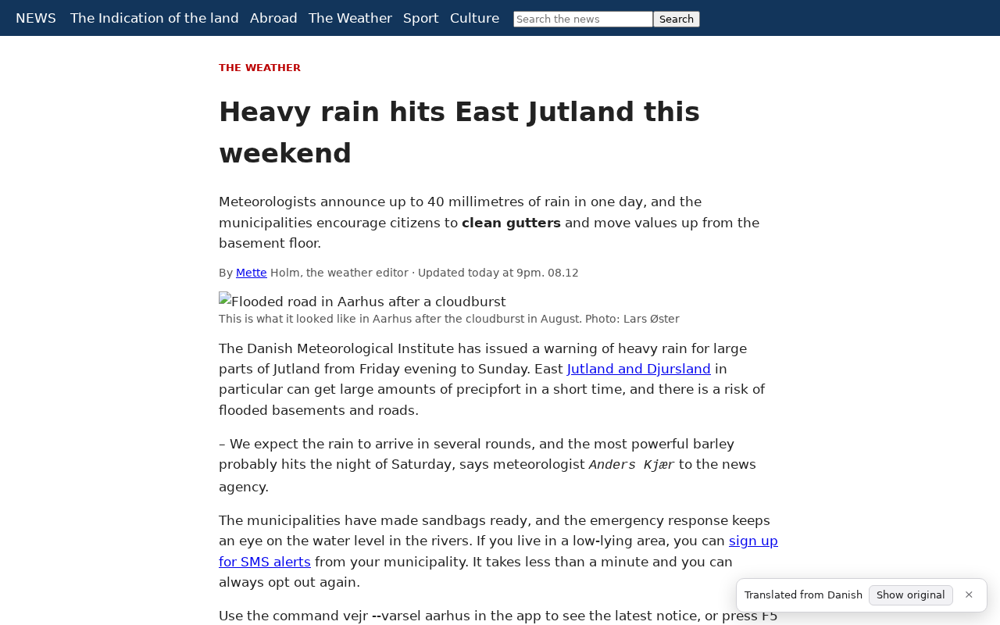
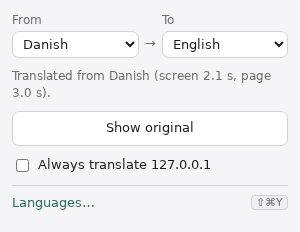
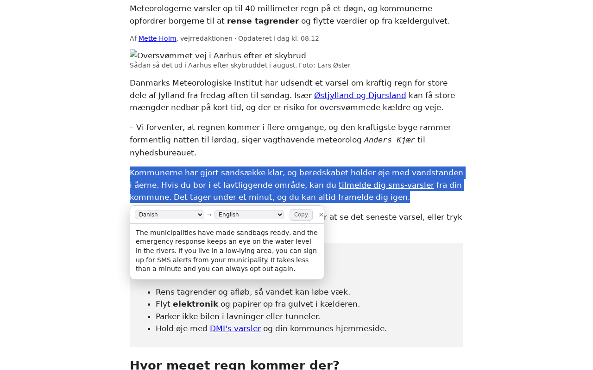
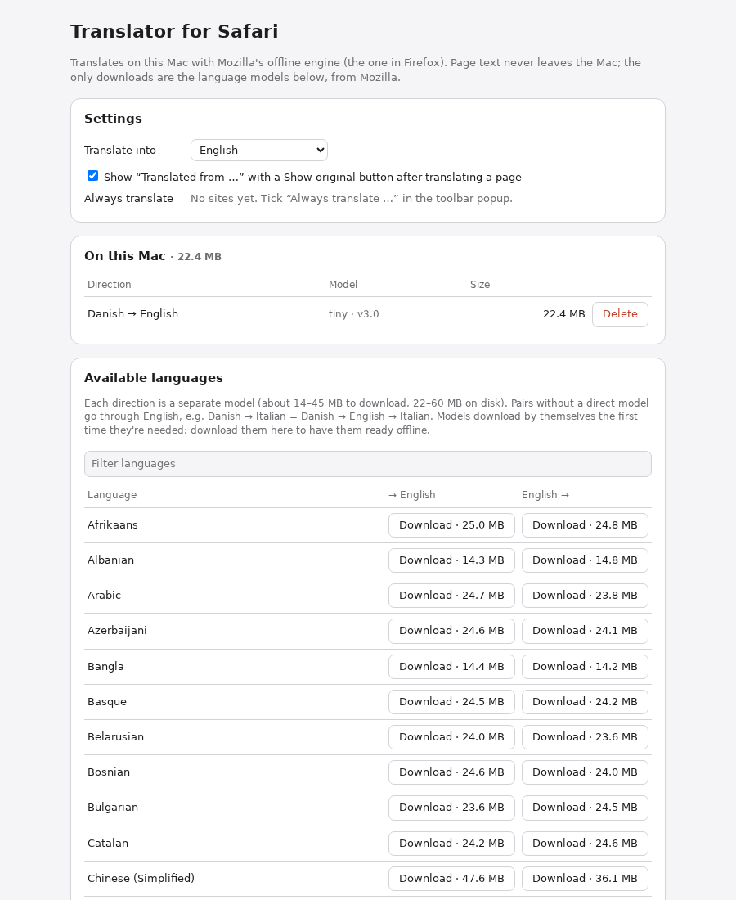

# Translator for Safari

Full-page translation in Safari, including languages Apple's translation doesn't support. Offline, on-device, using
Mozilla's translation engine.

It is a Safari Web Extension for macOS that runs the engine Firefox uses for its built-in translations
(Bergamot/Marian models in WebAssembly) inside Safari. Danish was the first reason for it. It is free, has no
limits, works offline once a language is downloaded, and page text never leaves the Mac.



| Popup | Translate a selection | Languages page |
|---|---|---|
|  |  |  |

## What it does

- **Toolbar button**: a popup with From (detected, changeable) → To (English by default, remembered), Translate /
  Show original, "Always translate <site>" and Languages…. **⇧⌘Y** does the same as the button: translate with the
  detected language, press again for the original.
- **Page translation**: the visible part first, then the rest. Links, bold and other inline markup stay where they
  are, and the page's own elements are kept, so its buttons and links still work. Text added later (infinite scroll,
  single-page apps) is translated as it appears; so are `title`, `alt`, `placeholder` and `aria-label`. Code,
  `<pre>`, form fields, editable areas, `translate="no"` and `.notranslate` are left alone.
- **Show original** puts back exactly what was there: the same text nodes, attributes and title.
- **Right-click › Translate Selection**: a bubble next to the selection with the translation, changeable
  languages and Copy.
- **Languages page**: target language, sites set to "always", the models on this Mac (size, delete), all
  available models (download ahead for offline use) and a speed check.
- A page already in the target language is left alone: the shortcut says so, and the popup's button reads
  "Already in English".

## Languages

Mozilla's model list (Firefox's Remote Settings collection `translations-models-v2`) had, in November 2026:

- 59 languages → English and 57 English → languages, Danish both ways among them.
- Every model goes to or from English. Any other pair goes **through English**: Danish → Italian is
  Danish → English → Italian, with both models downloaded on first use.
- Some languages have Mozilla's smallest ("tiny") models, Danish among them: fast and understandable, but rougher
  than a big cloud service. When Mozilla ships a newer model, the Languages page offers it.

Models are downloaded from Mozilla the first time a language is used, checked against Mozilla's SHA-256 (packed and
unpacked), unpacked (zstd) and kept in the extension's storage. A language pair takes 14–45 MB per direction.

## Install

There is no App Store or notarised download: you build the app yourself on your Mac, which takes a few minutes.
You need **macOS with Safari 26 or newer** and **Xcode** (free, from the App Store).

```sh
git clone https://github.com/pennico/safari-translator.git
cd safari-translator
tools/mac-build.sh            # signs with your Apple Development certificate (a free Apple ID is enough)
tools/mac-build.sh --unsigned # or: no certificate; Safari then needs "Allow unsigned extensions"
```

Then in Safari › Settings › Extensions, tick **Translator for Safari** and allow it on websites.
[BUILD.md](BUILD.md) has the details: signing with a free Apple ID, unsigned builds, trying it without building,
updating and uninstalling.

## Privacy

- Page text is read only by the extension's content script and the engine, both inside Safari on your Mac. Nothing
  is sent anywhere.
- The only network use is Mozilla's model list (`firefox.settings.services.mozilla.com`) and model files
  (`firefox-settings-attachments.cdn.mozilla.net`). Neither request contains page content.
- No accounts, analytics or settings sync. Settings stay in Safari's extension storage.
- The extension runs on all websites so that "Always translate" and right-click work everywhere, but it does nothing
  on a page until you ask it to (or the site is set to "always").

## How it works

```
page (content/content.js)  ── messages / port ──>  background (background/background.js)
  collect text units, visible first                   Safari: background page → Worker (engine/worker.js)
  apply in place, record for Show original            Chromium (tests): inside the service worker
  MutationObserver for new text                                │
                                                      engine/engine.js: Bergamot WASM (translate),
                                                      fastText lid.176 (detect), models in IndexedDB
```

- **Engine**: Mozilla's `bergamot-translator` 4.0 WebAssembly (v0.6.0, from Remote Settings `translations-wasm-v2`)
  with Firefox's matching JavaScript glue, configured as Firefox does. Outside Firefox it uses the WASM's built-in
  int8 matrix multiply. It needs plain WebAssembly SIMD only, not relaxed SIMD.
- **Language detection**: fastText `lid.176`, plus the page's `lang` attribute when the text sample is short or
  unclear. (Firefox's current detector, CLD2, needs `eval`, which extension pages may not use, and Safari has no
  `i18n.detectLanguage`.)
- **Text units**: a run of text and inline elements inside a block. Units with markup go to the engine in its HTML
  mode, with each inline element as a placeholder tag; the answer is read by a small parser, never inserted as HTML.
  If the elements come back in the same order only the text nodes change; in another order the same nodes are moved
  (never iframes, media, form fields or custom elements); if the engine dropped a tag, that unit is translated text
  node by text node.
- **Background lifetime**: Safari unloads an idle extension background after 30 seconds even while a reply is
  pending, so long calls (downloading and loading a model) use a port with progress messages.
- **Bundled vs downloaded**: the engine (5 MB), fastText (1 MB) and its language model (0.9 MB) are bundled, because
  they must match the bundled glue and detection has to work before any download. The translation models are not.

## Speed

From "Translate" to the visible screen and to the whole page, measured in headless Chromium on a 2018 Intel desktop
CPU (`jstest/speed.mjs`, medians):

| Page | Engine | Visible screen | Whole page |
|---|---|---|---|
| Test article, 1,265 words | already loaded | 0.6 s | 3.2 s |
| | loaded from disk | 1.2 s | 3.8 s |
| | first use (no network time) | 2.4 s | 5.1 s |
| Live Danish news article, 1,483 words | already loaded | 1.0 s | 4.6 s |
| | loaded from disk | 1.7 s | 5.2 s |

The engine is single-threaded, so one core's speed is what counts; Apple silicon cores are faster than that CPU. The
page itself is busy for only a few milliseconds. The popup shows the real numbers after each translation, and the
Languages page has a speed check.

## Limits

- Quality depends on Mozilla's model for the language; the small ones are understandable, not polished. Names and
  link boundaries sometimes shift.
- Text inside shadow DOM (web components), canvas and images is not translated, nor are `<select>` options.
- Each frame translates itself; frames from other sites follow the tab.
- A page that keeps rewriting text it was given back is left alone after 5 rewrites of the same element.
- The engine's memory grows to 150–300 MB while translating; Safari frees it when it unloads the idle background.
- macOS only for now (Apple's converter can add an iOS/iPadOS target later).

## Development

[DEVELOPMENT.md](DEVELOPMENT.md): the layout, the headless tests (Chromium, and the engine in WebKit), updating the
bundled engine files, and where to look when something fails in Safari.

## Licence

[Mozilla Public License 2.0](LICENSE), the licence of the engine and models it builds on. Bundled third-party files
and their licences: [THIRD-PARTY.md](THIRD-PARTY.md). Not affiliated with Mozilla or Apple; Safari is a trademark of
Apple Inc., Firefox of the Mozilla Foundation.
